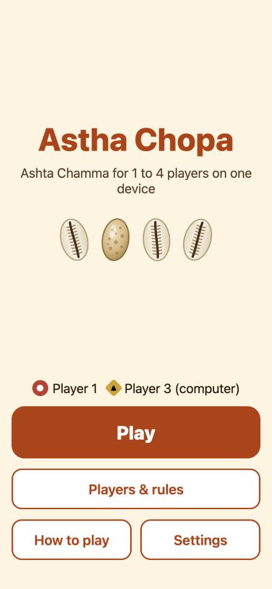
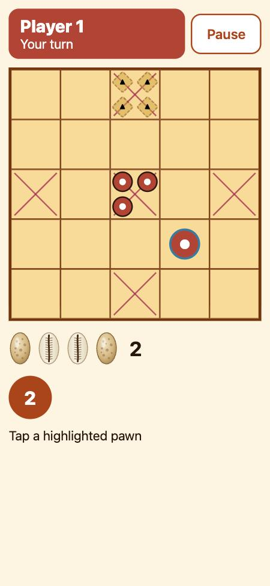

# Astha Chopa

Offline, pass-and-play **Ashta Chamma** for 1 to 4 players on one phone or tablet, with computer opponents. Built with Expo (SDK 58), React Native and TypeScript.

Ashta Chamma (also called Chowka Bara, Daayam or Kanna Kauri) is a traditional Indian race game on a 5x5 board. Four cowrie shells are thrown instead of dice, and each player races four pawns around the outer ring, into the inner ring and to the centre square.

| Home | Game | Winner |
|---|---|---|
|  |  |  |

## Features

- 1 to 4 players on one device; any seat can be a person or a computer player (Easy, Medium, Hard).
- Faithful cowrie odds: 1, 2 and 3 are common, Chamma (4) and Ashta (8) are rare and grant another throw.
- Hits, safe squares, doubles and the inner-ring gate, with rule options (inner ring open or after a hit, doubles, triple penalty and more).
- Large buttons and clear text for children and older players; four themes that meet WCAG AA contrast.
- Cowrie sounds, spoken results ("3", "Chamma!"), a clap when a pawn reaches home and a winner celebration.
- English and Hindi.
- Fully offline: no accounts, no ads, no analytics, no network requests. Games and settings are saved on the device only.

## Requirements

- Node.js 22.13+ or 24.3+, and npm.
- For running on a device: a [development build](https://docs.expo.dev/develop/development-builds/introduction/) (Xcode for iOS, Android Studio for Android), or a cloud build with EAS.
- iOS 16.4 or later; Android 7 (API 24) or later.

## Getting started

```bash
npm install
```

The app uses native modules (MMKV storage), so it runs in a development build rather than Expo Go:

```bash
npx expo run:ios
```

```bash
npx expo run:android
```

or build in the cloud:

```bash
npx eas-cli@latest build --profile development
```

Expo Go also works for a quick look; saves then fall back to AsyncStorage.

### Run in a web browser (local, no ngrok)

The fastest way to try the app is in a desktop browser. Everything runs on your machine; no tunnel (ngrok), account or device is needed.

1. Install dependencies (once):

   ```bash
   npm install
   ```

2. Start the web dev server:

   ```bash
   npx expo start --web
   ```

   The app opens in your default browser at http://localhost:8081. If it does not open, visit that address yourself. Edits reload automatically. Press `Ctrl+C` to stop.

3. Optional: to open it on a phone or tablet on the same Wi-Fi, use your computer's local IP instead of `localhost`, for example `http://192.168.1.20:8081`.

On the web, saves use the browser's local storage, and sound and speech depend on the browser (click once on the page to allow audio).

## Checks

```bash
npm run typecheck
```

```bash
npm run lint
```

```bash
npm test
```

```bash
npm run audit:deps
```

`audit:deps` fails if any dependency can reach the network. `npm run sim` plays thousands of bot-vs-bot games against the rules engine and checks its invariants. End-to-end flows for [Maestro](https://maestro.mobile.dev) are in `.maestro/` (`npm run e2e`).

## Project structure

| Path | What |
|---|---|
| `src/engine/` | Pure rules engine: a reducer over immutable game state with a seeded RNG. No React, Expo, clock or `Math.random`. |
| `src/bot/` | Computer players. Imports only `src/engine`. |
| `src/app/` | Expo Router routes (thin screens). |
| `src/ui/` | Screens, board and controls, themes. |
| `src/store/`, `src/services/`, `src/i18n/` | State (Zustand), storage, sound and speech, translations. |
| `src/config/app.json` | App name and identifiers, the single place to rename the app. |
| `scripts/` | Dependency audit, simulator, rule-coverage report, sound generator. |
| `docs/` | [Product requirements](docs/prd.md), [spec](docs/specs/ashta-chamma-v1/), performance notes, manual test checklist. |

## Known limitations

- Pass-and-play only: no online or local-network multiplayer.
- Sound, speech, haptics and screen-reader behaviour are verified in tests and on the web preview, not yet on every physical device.
- Not yet published to the App Store or Google Play.

## Contributing

See [CONTRIBUTING.md](CONTRIBUTING.md). To report a security issue, see [SECURITY.md](SECURITY.md).

## License

[MIT](LICENSE) © 2026 Rachit Tyagi
